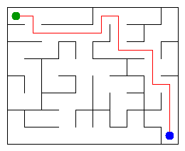

# Assignment 3. Maze Escape

Student ID:253970
Name:Zhurek Aldiyar
Group:SE-2540
Maze size (rows x columns):8 x 10 cells, 142 walls.

This file is the report. Fill it in as you go. How to start: `START_HERE.md`. The task: `docs/Assignment3.pdf`.

## Program output

The 13 lines your program prints on your data (`java -cp out Main`):

Broken: 79
Kept: 63
Last broken wall: 105
MST cost: 21629
Heaviest broken wall: 642
Path length: 18
DFS visited: 30
Dead ends: 27
Zones: 8
Largest zone: 14
Is DAG: 0
Flow stages: 4
Fastest route cost: 1

My maze:

## Questions

Mission 0. What do find and union do, and what makes them fast in your code?

`find` returns the root of the set that contains a cell, and `union` joins two sets if they are different (it returns false if they are already one set). They are fast because of union by size (the smaller tree goes under the larger one) and path compression in `find`, so the trees stay almost flat and each operation takes almost constant time.

Mission 1. Why is Broken always `R*C - 1`, and Kept always `(R-1)*(C-1)`?

Every successful `union` reduces the number of sets by one. We start with `R*C` sets (one per cell) and the grid is connected, so we end with one set, which means exactly `R*C - 1` successful unions (broken walls). The total number of walls is `R*(C-1) + C*(R-1)`, and subtracting `R*C - 1` leaves `(R-1)*(C-1)` walls that stay.

Mission 2. My MST cost from Kruskal and from Prim, and why they are equal:

Both give 21629. Both algorithms build a minimum spanning tree, and since all wall costs are different, the minimum spanning tree is unique, so any correct algorithm must find the same one.

Mission 3. Why is there exactly one path between two cells? How did you avoid a stack overflow on a huge maze?

The broken walls connect all cells and create no cycle (we only break a wall when it joins two different sets), so they form a tree, and a tree has exactly one simple path between any two vertices. I wrote DFS iteratively with my own stack array and a "next direction" array instead of recursion, so the depth of the maze does not use the call stack.

Mission 4. Why does the second pass of Kosaraju go on the reversed graph? Why do the slides have no cycle exactly when Zones equals the number of cells?

The cell that finishes last in the first pass belongs to a zone with no slides coming in from other zones. On the reversed graph the slides between zones point the other way, so DFS from that cell can only reach its own zone and cannot leak into other zones. A cycle makes all its cells reachable from each other, so they share one zone; and a zone with two or more cells always contains a cycle. So there is no cycle exactly when every cell is a zone of its own, i.e. Zones equals the number of cells.

Mission 5. Why is it enough to go through the zones in the order of their numbers? What does this pass cost?

The second pass of Kosaraju numbers the zones in topological order, so every slide between zones goes from a smaller number to a larger one. When we reach zone `z`, all slides into it have already been processed, so its longest chain and cheapest cost are final, and no priority queue is needed. The pass costs O(n + S) time and memory (S = number of slides), compared with O(S log n) for Dijkstra.

## Timing (Mission 7)

Milliseconds, 5 runs each, from `java -cp out Bench`.
| maze | Kruskal | Prim |
|---|---|---|
| 100x100 | 9 ms | 9 ms |
| 300x300 | 25 ms | 69 ms |
| 1000x1000 | 462 ms | 1853 ms |

The number of walls grows like size², so a 3 times bigger side gives about 9 times more walls, and the time grows a bit faster than that because of the log factor (O(W log W) for sorting in Kruskal and for the priority queue in Prim). Kruskal went from 25 ms (300x300) to 462 ms (1000x1000), and Prim from 69 ms to 1853 ms, so both grow roughly with the number of walls. Prim is slower on big mazes because it pushes many entries into a priority queue of boxed `Long` objects, while Kruskal sorts one primitive array; the 100x100 times are small and noisy because of JVM warm-up.

## Complexity

| algorithm | time | space | assumptions |
|---|---|---|---|
| DSU find and union | O(α(n)) amortized per operation, almost constant | O(n) | union by size and path compression |
| Kruskal | O(m log m) | O(m) | sorting dominates; the DSU part is O(m α(n)) |
| Prim | O(m log m) | O(m) | lazy version with a binary heap priority queue; each wall can be pushed twice |
| DFS | O(n + m) | O(n) | iterative, own stack; in the maze tree m = n - 1 and every cell has at most 4 neighbours |
| Kosaraju | O(n + m) | O(n + m) | two DFS passes with explicit stacks, m = number of slides; adjacency lists built by counting |
| Route in the zone graph | O(n + m) | O(n + m) | one pass over zones in topological order, no priority queue; m = number of slides |

## Before you submit

- data/walls.txt, data/slides.txt and output/maze.png are in the repository.
- `java tools/Check.java` shows all examples right.
- This README is filled in, the program output and the section AI use included.
- The work is pushed to main (at least one commit per mission) and the repository is public.
- The link is attached in Moodle.
